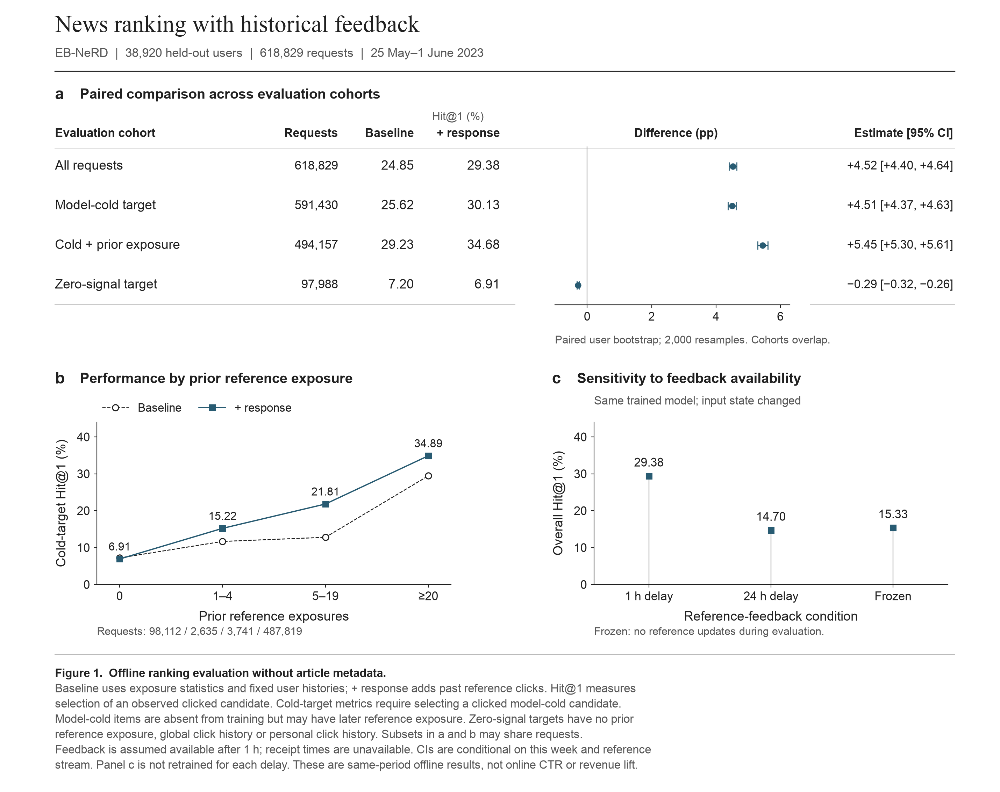
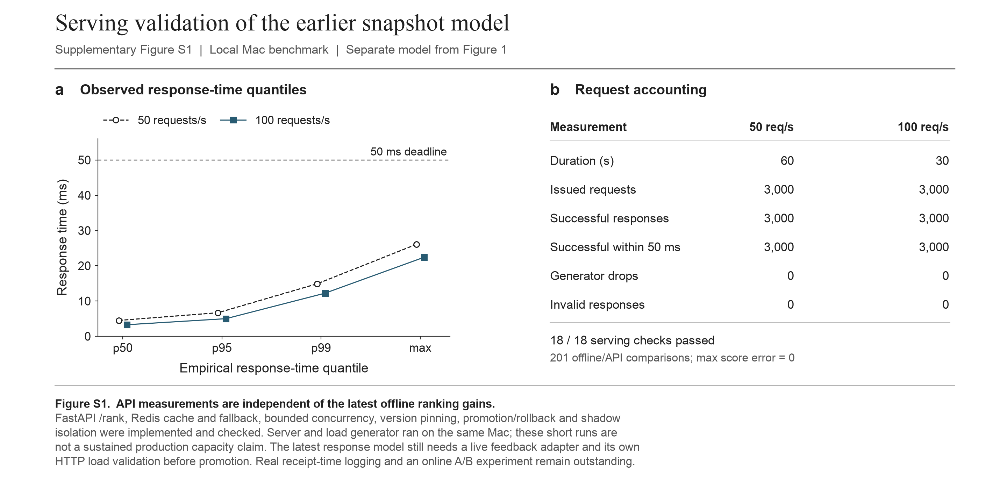

# Candidate ranking with historical feedback

An ML engineering study of **which candidate to rank first, what information is available at that moment, and how to return the ranking within a latency budget**.

The project began with FairJob advertising logs and moved to EB-NeRD news impressions when timestamp and item-history limitations prevented a convincing evaluation. It combines reproducible ranking experiments, a FastAPI/Redis serving implementation, and an audit of the conditions under which an apparent improvement holds.

[Portfolio case study](https://hdjang.com/projects/candidate-ranking/) · [Research note](docs/RESEARCH_NOTE.md) · [Reproduction guide](docs/REPRODUCIBILITY.md) · [Data access](docs/DATA_ACCESS.md)

## Main finding

Adding historical click responses improved top-1 selection on **38,920 held-out users and 618,829 complete candidate sets**, using no article metadata. The improvement did **not** extend to items with no available history, and it depended strongly on feedback freshness.

| Evaluation subset | Exposure/history baseline | + historical click response | Difference, percentage points |
|:--|--:|--:|--:|
| All requests | 24.85% | 29.38% | +4.52 [95% CI: +4.40, +4.64] |
| Clicked item absent from model training | 25.62% | 30.13% | +4.51 [+4.37, +4.63] |
| Clicked item absent from all available histories | 7.20% | 6.91% | −0.29 [−0.32, −0.26] |



*User-level paired bootstrap, 2,000 resamples. Evaluation uses new users within the same calendar week, not a new time period. Feedback availability is assumed after one hour because actual receipt timestamps are unavailable. Hit@1 measures agreement with observed clicks; it is not an online CTR or revenue lift.*

[Editable SVG](reports/research-figures/figure-1-feedback-ranking.svg) · [Exact values and provenance](reports/research-figures/figure-data.json) · [Frozen evaluation](reports/ebnerd-top1-feedback/final_results.json)

## Why the experiment changed direction

1. **Click prediction was not enough.** A context-only FairJob model had a higher AUC than the full model, but gave every candidate in the same request the same score. Ranking needed a within-request evaluation.
2. **Promising subgroups did not reproduce.** Larger candidate sets initially looked favorable. New user splits, alternative ranking objectives and cross-fitted response features failed to establish a stable FairJob selection improvement.
3. **Better news scores raised a timing problem.** EB-NeRD supplied timestamps and reading histories, but article metadata came from a later snapshot. The project audited feature availability instead of treating the initial gain as deployable evidence.
4. **Past response was the useful additional signal.** Article metadata was removed. Exposure and click statistics used explicit maturity cutoffs; predictions were frozen before opening fresh-user labels. This improved selection for items with usable feedback.
5. **The remaining failure became a data requirement.** Zero-history selection declined. With the same trained model, delaying feedback to 24 hours reduced overall Hit@1 from 29.38% to 14.70%. Larger models alone do not supply missing item information or actual receipt timestamps.

The [research note](docs/RESEARCH_NOTE.md) documents the hypotheses, controls, negative results and remaining uncertainty.

## Engineering implementation

| Component | Implemented behavior |
|:--|:--|
| Data and features | User-disjoint FairJob splits; chronological EB-NeRD experiments; training-only transforms; delayed response aggregates; shared inference features |
| Models | LightGBM classification/ranking, PyTorch embedding MLP, DCN-V2; saved preprocessing and model bundles |
| Evaluation | Complete candidate sets, uniform tie handling, cold-target selection, paired user bootstrap, metadata ablation, feedback-delay sensitivity |
| Serving | FastAPI `/rank`, Redis MGET, cache fallback, bounded concurrency, candidate-order invariance and offline/API parity |
| Release and operations | MLflow registry, separate shadow process, evidence-gated promotion, rollback, Prometheus/Grafana configuration |
| Logging contract | Request-time feature snapshots and separate closed feedback with actual availability/receipt timestamps |

The latest response model is an **offline research artifact**. The existing HTTP service uses an earlier snapshot model; live feedback ingestion and a new serving validation are required before promoting the latest model.

## Serving measurements

The earlier news API served **3,000/3,000 requests within 50 ms at 100 requests/s for 30 seconds**, with p95 **5.00 ms**. A separate 50 requests/s run lasted 60 seconds. Server and load generator ran on the same local Mac.



These short measurements validate the exercised local configuration, not sustained production capacity. Eighteen serving checks covered parity, candidate limits, invalid history, cache corruption/outage/recovery, shadow isolation, promotion and rollback. See the [serving report](reports/ebnerd-serving/verification.json) and [editable figure](reports/research-figures/figure-s1-serving.svg).

## Inspect the project without downloading data

The published repository contains code, synthetic test fixtures, aggregate experiment reports and figures. Source datasets, trained bundles, per-user predictions, request replays and local service state are excluded.

```bash
git clone https://github.com/deardanny/candidate-ranking.git
cd candidate-ranking
python3.12 -m venv .venv
.venv/bin/python -m pip install -e '.[dev,week2,week3,v2]'
python3 scripts/run.py -m pytest -q
```

**Latest local validation:** 131 tests passed. The tests exercise synthetic inputs and do not require the licensed datasets. Dependency versions are pinned in `pyproject.toml` and the `requirements-*.lock` files.

To regenerate the research figures from the published aggregate reports:

```bash
.venv/bin/python -m pip install -r requirements-figures.txt
python3 scripts/run.py scripts/render_research_figures.py
```

Full data preparation, model training and API startup are described in the [reproduction guide](docs/REPRODUCIBILITY.md). They require separately obtained data and locally generated model artifacts; this repository does not ship a pre-trained serving bundle.

## Repository map

```text
src/fairjob_ranker/
  ebnerd/                  chronological features, feedback state, evaluation, API
  diagnostics/             ablation, residual and reproduction experiments
  v2/                      neural models, registry, shadow and release controls
  log_contract.py          request snapshots and closed-feedback contracts
scripts/                   preparation, training, audits, serving and figure generation
tests/                     synthetic contract, feature, metric and service checks
configs/                   experiment and serving configurations
schemas/                   request and feedback JSON Schemas
reports/                   selected aggregate evidence and research figures
docs/                      research narrative, methods and reproduction instructions
monitoring/                Prometheus and Grafana configuration
```

## Data and scope

- **FairJob:** Criteo advertising data, distributed under CC BY-NC-SA 4.0. The study concerns candidate selection; it does not establish fairness guarantees.
- **EB-NeRD:** Ekstra Bladet news recommendation logs. Obtain access and accept the publisher's applicable research terms independently.
- The datasets are different tasks. FairJob and EB-NeRD results are not pooled into a single benchmark or compared as equivalent business outcomes.
- No online A/B test, revenue measurement, certified production availability or first-exposure item-generalization claim is made.

See [dataset references and access instructions](docs/DATA_ACCESS.md). Public availability of this code does not grant rights to the source datasets.
