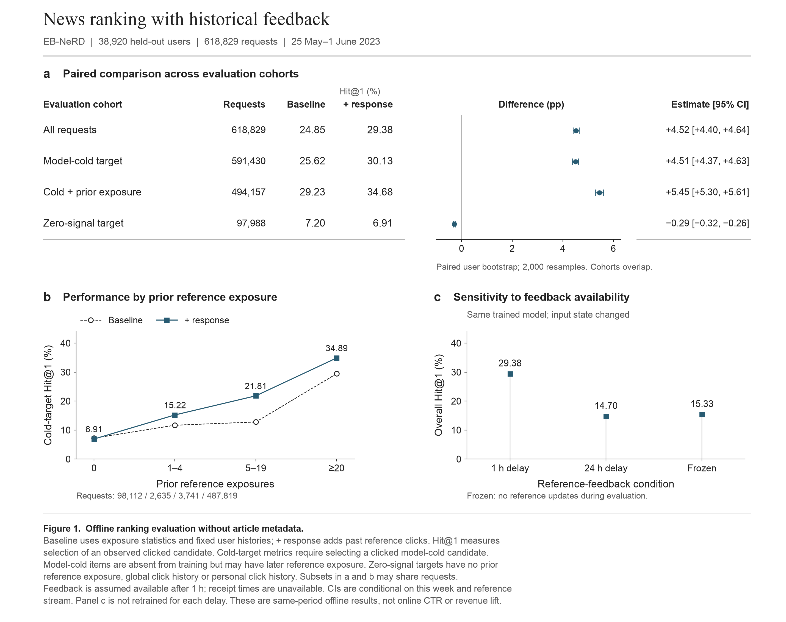
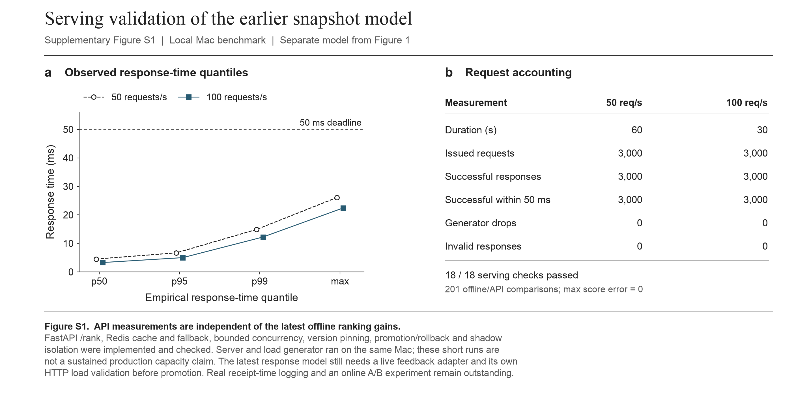

# Selecting the first candidate under incomplete information

## Problem

An advertising or recommendation service allocates a small number of visible positions among competing candidates. Predicting that a user is likely to click something does not establish which candidate should receive the first position. The decision also has to use features available when the request arrives and return before the serving deadline.

This project treats ranking quality, feature availability and serving reliability as separate claims that require separate evidence.

## From an advertising baseline to a data audit

FairJob supported a useful engineering baseline: cleaning, user-disjoint splits, shared feature transforms, LightGBM and neural models, and an HTTP ranking service. The cleaned dataset contained 1,050,085 candidate rows. However, promising ranking results did not consistently reproduce across user splits.

A context-only model provided an informative counterexample. Its AUC was about 0.791, higher than the full-feature model's 0.766, while all candidates within a request received the same context score. Its within-request pair accuracy was 0.5. A better global click predictor was not necessarily a better selector.

Additional experiments changed the ranking objective, modeled ad-specific residuals and constructed response statistics using user-level cross-fitting. These did not establish a stable selection improvement. A promising large-candidate subgroup also failed to reproduce. This motivated a move to EB-NeRD, which supplied explicit request timestamps, complete displayed candidate sets and reading histories.

The first EB-NeRD snapshot experiment improved NDCG@5 from 0.5468 to 0.5840. That result could not establish a production-time improvement: article fields were observed in a later snapshot without historical versions. A subsequent audit included 153 model fits, metadata removal and permutation, and availability-delay controls. The later result below removes the article table entirely.

## Controlled feedback experiment

The baseline combines prior exposure statistics with fixed reading histories. The response model adds matured reference click counts, exposure counts and smoothed click rates over multiple lookback windows. Candidate ID values are not used as numeric model features. Article titles, categories, publication times and modification times are absent from this path.

The experiment compared ranking settings on two chronological development intervals and three seeds. Development results selected the response model before the fresh-user evaluation. Training labels ended two hours before the final model time, allocating one hour for assumed feedback maturity and one for model construction.

Fresh evaluation users were selected without their click labels and excluded every user appearing in the original small dataset's histories or behaviors. Features and predictions were saved and hashed before evaluation labels were opened. Fresh-user clicks did not enter training or the online reference aggregate.

The resulting evaluation included **38,920 users, 618,829 requests and 7,417,634 candidate rows**. It uses the same May 25–June 1, 2023 calendar week as the original evaluation. It is a new-user check, not a new-period test.

## Evaluation definitions

| Term | Definition |
|:--|:--|
| Hit@1 | Probability that the top-ranked candidate is an observed clicked item, with uniform treatment of tied top scores |
| Model-cold | Item absent from fitted training candidates and the original training history; it can accumulate reference feedback later |
| Cold-target Hit@1 | On requests with a clicked model-cold candidate, success requires choosing such a clicked candidate; choosing a clicked warm candidate does not count |
| Adapted cold target | A cold clicked candidate with an available prior reference exposure |
| Zero-signal target | A clicked candidate without available reference exposure, global fixed click history or the user's fixed click history |

All original candidates compete. No negative sampling or removal of warm competitors is used. A request with multiple clicked candidates may belong to several target subsets; these counts are not additive.

## Results and failure cases

Historical response improved overall Hit@1 by **4.52 percentage points** over the exposure/history baseline; the user-level paired 95% bootstrap interval was **[4.40, 4.64]**. Model-cold target selection improved by **4.51 points [4.37, 4.63]**.

Zero-signal selection moved in the opposite direction: **7.20% to 6.91%**, or **−0.29 points [−0.32, −0.26]**. These results support adaptation after feedback becomes available, not the ability to distinguish entirely new items on their first exposure.

Holding the trained model fixed and delaying the online reference inputs by 24 hours reduced overall Hit@1 to **14.70%**. Freezing the reference state before evaluation produced **15.33%**. This is a sensitivity test; each delayed condition was not separately retrained or optimized.

A subsequent policy allocated some decisions uniformly among zero-signal candidates. Eight probabilities were evaluated on the two development intervals. None met the predeclared simultaneous improvement criterion for overall, cold-target and zero-signal selection. A continuous feasibility check also found no qualifying probability for that particular policy and margin. The second reserved user cohort was not opened. This rejects the tested policy, not every possible exploration or routing method.

## What remains uncertain

EB-NeRD does not supply actual feedback receipt/completion times or completion times for the fixed histories. The protocol assumes fixed histories are available at the official split boundary and reference feedback is available after one hour. Removing article metadata and testing event-time cutoffs addresses specific leakage pathways; it does not certify production-time availability.

Bootstrap intervals are conditional on the observed week and reference stream. They do not measure variation across future weeks or deployments. Observed-click agreement is not a counterfactual estimate of online CTR, user value or revenue.

## Independent implementation checks

- Reconstructed 835,524 response-feature values independently; maximum absolute error was zero.
- Recomputed 15,000 request-level metric values and checked 90,000 reloaded predictions.
- Checked maturity boundaries, future/current-label invariance, candidate permutations, duplicate clicks and cold-target competition against warm candidates.
- Reran the repository's synthetic test suite before publication: **131 passed**.

The [feature verification report](../reports/ebnerd-top1-feedback/verification.json), [protocol](../reports/ebnerd-top1-feedback/protocol.json) and [final metrics](../reports/ebnerd-top1-feedback/final_results.json) preserve the aggregate evidence.

## Serving is a separate result

The existing API uses an earlier article-snapshot model. It implements batch feature retrieval, fallback, bounded concurrency, pinned model versions, a separate shadow process and evidence-gated promotion/rollback. Its measured 100 requests/s run completed 3,000 requests within 50 ms, with p95 5.00 ms; the run lasted 30 seconds on a local Mac. Eighteen serving checks passed.

The latest feedback model remains offline. A real receipt-time feedback adapter and its own HTTP parity/load validation are needed before promotion. The request and closed-feedback contracts in `schemas/` describe what future data collection must record; they do not reconstruct timestamps missing from EB-NeRD.

## Next experiment

The useful next inputs are request-time candidate snapshots and actual feature/feedback availability timestamps. Entirely new candidates need distinguishable attributes available at their first serving opportunity. A later calendar period and an online randomized experiment would then test temporal generalization and business impact.

The engineering contribution is the chain from candidate-level evaluation through feature-availability checks to a reversible serving release, together with the explicit decision not to promote a model whose operational input assumptions remain unverified.
