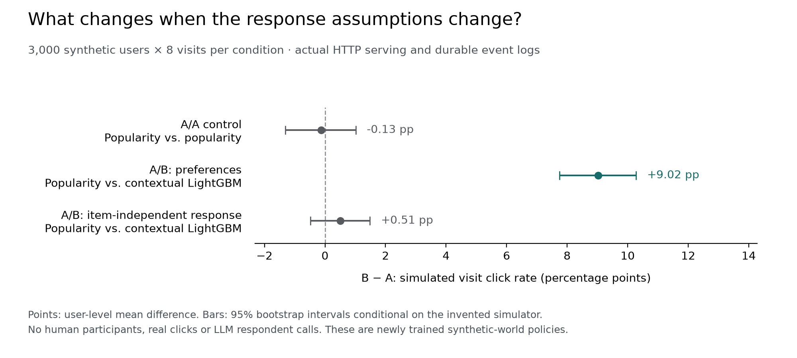

# 실행 결과의 해석

**구현과 실행은 완료했다. 3,000개의 확률형 가상 사용자이며, LLM 응답자는 아니다.** 실제 HTTP와 서버 저장을 사용한 것은 엔지니어링 실행 경로이고, 광고에 대한 반응은 전부 합성이다.

## 관측한 결과

| 비교 | A | B | 차이와 조건부 95% 구간 |
|---|---:|---:|---:|
| 같은 인기순끼리 A/A | 21.94% | 21.82% | −0.13%p [−1.31, +1.01] |
| 인기순 → 문맥 LightGBM | 21.94% | 30.96% | +9.02%p [+7.74, +10.28] |
| 광고와 무관하게 반응하도록 변경 | 15.30% | 15.81% | +0.51%p [−0.48, +1.49] |

각 사용자는 동일 그룹에서 8회 방문했다. A는 1,480명, B는 1,520명이다. 같은 3,000명으로 세 실험을 실행했으므로 총 방문은 72,000회이고, 사용자 수가 9,000명이 된 것은 아니다. 표의 값은 방문에서 모의 클릭이 발생한 비율이며, 실제 사람에 대한 CTR 측정값이 아니다.

문맥 모델은 우리가 정의한 관심·예산·거리·시간의 관계를 학습했다. 이 관계가 있는 반응 모델에서는 차이가 나타났고, 관계를 없앤 반응 대조군에서는 구간이 0을 포함했다. A/A의 구간도 0을 포함한다. 대조군의 결과는 이번 실행의 배정·집계가 무조건 새 모델에 큰 이득을 주는 방식은 아니었음을 점검하는 자료다. 모든 편향이 없다는 보증은 아니다.

## 무엇이 실제로 연결되었는가

`프로필과 방문 생성 → 별도 서버의 /rank → 사용자 고정 배정 → 모델 추론 → SQLite 노출 저장 → 클라이언트의 모의 선택 → /events/feedback → 귀속 검증·중복 제거 → 사용자 단위 분석`

- 서버가 저장한 요청 72,000건과 닫힌 피드백 72,000건을 전부 검증했다.
- 클라이언트 요청·응답·선택과 서버 기록이 일치했다. 실패·누락·불일치는 0건이었다.
- 요청과 피드백을 90쌍 재전송해 중복 집계가 발생하지 않는 것을 확인했다.
- HTTP 출력과 직접 모델 추론을 120회 비교해 상위 광고와 점수의 일치를 확인했다.
- 전체 테스트 144개가 통과했다. 새 테스트 13개에는 동시 재전송, 재시작, 변조·미노출 클릭 거부, 미래 피드백 거부, 누락 시 분석 중단이 포함된다.
- 훈련 2,000명과 검증 400명은 평가 3,000명과 별도 ID·난수 계열로 생성했다. 평가를 보기 전에 모델을 고정했다. LightGBM은 검증 데이터에 따라 104회 boosting을 사용했다.

HTTP 실험 구간은 약 172초였다. 본 A/B의 요청 왕복 지연은 중앙값 8.62ms, p95 91.98ms였다. 서버와 생성기가 같은 컴퓨터에서 동시 실행되었고, SQLite 영속 저장과 클라이언트 대기가 포함된다. 원인을 분리한 성능 실험이 아니며 기존 뉴스 API의 부하 측정과 직접 비교할 수 없다. 이번 구성의 p95가 50ms 이하라고 주장하지 않는다.

## 포트폴리오에서 말할 수 있는 내용

> 실제 트래픽이 없어 모델의 온라인 효과를 바로 검증할 수 없었다. 그래서 3,000개의 가상 사용자로 랭킹 서빙, 사용자별 실험 배정, 노출·피드백 귀속, 재전송 중복 제거와 분석을 연결했다. 새 모델이 항상 이기도록 만든 검증을 피하려고 A/A와 광고 무관 반응 대조군을 함께 실행했다. 설정한 세계에서는 개선이 있었지만, 반응 가정을 바꾸면 차이가 사라졌다. 이를 인간 CTR 향상과 분리해, 실험 시스템의 검증 결과로 기록했다.

기존 FairJob 또는 EB-NeRD 모델의 개선, 실제 광고 CTR +9.02%p, 실제 사용자 3,000명 대상 실험이라고 쓰면 안 된다. 이 비교에 사용한 두 정책은 가상 광고 환경에서 새로 만든 모델이다. 사용자 반응 규칙도 실제 사람에게 보정하지 않았으며, 학습과 평가가 같은 가상 세계를 공유한다.

[전체 집계 및 원본 증거 해시](results.json) · [실행 보고서](README.md) · [재현 및 API 안내](../../docs/SYNTHETIC_AB.md) · [편집 가능한 그림](synthetic-ab.svg)
